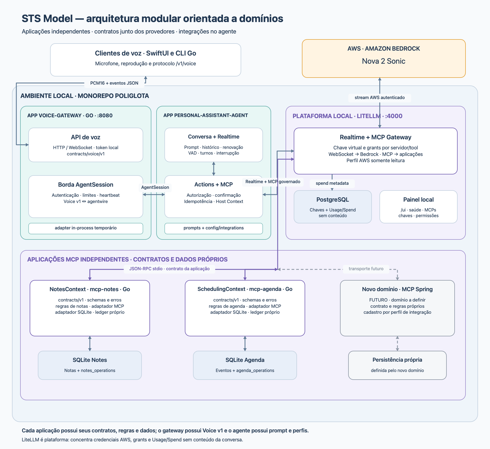

# STS Model POC

Assistente speech-to-speech em português brasileiro. O app Apple envia PCM16
para um gateway Go. O gateway cuida do transporte público e entrega a sessão à
aplicação `personal-assistant-agent`, dona da conversa e do acesso ao endpoint
Realtime do LiteLLM para chegar ao Amazon Nova 2 Sonic no Bedrock.

```text
App Apple / voice-client → voice-gateway (:8080) → personal-assistant-agent
                              │                       │
                       Voice Protocol v1       Prompt + Actions + MCP
                              │                       │
                         AgentSession          LiteLLM (:4000) → Bedrock/Nova
                                                      ├─ PostgreSQL Usage/Spend
                                                      ├─ mcp-notes → SQLite Notes
                                                      └─ mcp-agenda → SQLite Agenda
```

O agente usa uma chave virtual restrita ao
modelo `nova-sonic`, à rota Realtime e aos MCPs selecionados. LiteLLM é o único
componente com o perfil AWS e também a fonte de monitoramento de custo. Cada
aplicação MCP possui seus contratos, regras, migrações e dados; o gateway possui
o contrato público de voz. Prompt, confirmação e perfis confiáveis de consumo
pertencem ao agente. `agent-session/v1` remoto em loopback é o padrão. O gateway
não recebe credenciais LiteLLM/MCP. O gateway não carrega o runtime do agente. Desde `v0.11.0`, rollback exige
restaurar o conjunto de binários/configuração `v0.10.x`.



O PNG é gerado por `scripts/render_architecture.swift`. Depois de alterar o
fluxo, execute `make architecture-diagram` para mantê-lo sincronizado com a
documentação.

## Pré-requisitos

- macOS com Xcode para o app Apple;
- Go 1.27 ou mais recente;
- Python 3 para o supervisor local (não existe bridge Python de inferência);
- Docker Desktop;
- acesso ao Nova 2 Sonic em `us-east-1`.

## Início recomendado

Prepare um perfil AWS/SSO e o arquivo local `deploy/litellm/.env`. Depois:

```bash
make dev
```

O assistente escolhe provider, perfil AWS, MCPs, fixtures e exposição de rede.
Para Nova, ele:

1. sobe LiteLLM e PostgreSQL;
2. monta `~/.aws` somente no container LiteLLM, em modo somente leitura;
3. valida a identidade dentro desse container;
4. cria/atualiza a chave virtual `sts-go-gateway`;
5. compila e inicia o agente em loopback e depois o gateway, com ambientes separados
   e uma credencial interna aleatória por execução.

Nova e fake usam agente remoto. Fake dispensa Docker/AWS e configuração LiteLLM.
O modo `inprocess` foi removido em `v0.11.0`; ele permanece na tag `v0.10.0`.

O app continua usando `ws://127.0.0.1:8080/v1/voice`; seu protocolo público
não mudou. O painel LiteLLM fica em <http://127.0.0.1:4000/ui>.

Veja o passo a passo completo de AWS, cadastro do modelo no painel e
Usage/Spend em [docs/nova-litellm-runbook.md](docs/nova-litellm-runbook.md).

## Execução manual

Em um shell exclusivo para o agente:

```bash
AWS_PROFILE=sts-poc make litellm-up
export STS_PROVIDER=nova
export STS_LITELLM_URL=http://127.0.0.1:4000
export STS_LITELLM_API_KEY='chave-virtual-sts-go-gateway'
export STS_AGENT_PROMPT_FILE="$PWD/apps/personal-assistant-agent/prompts/system.md"
export STS_AGENT_TOKEN='credencial-interna-local'
make agent
```

Em outro shell, sem configuração LiteLLM/MCP:

```bash
export STS_PROVIDER=nova
export STS_AGENT_MODE=remote
export STS_AGENT_TOKEN_GATEWAY='credencial-interna-local'
export STS_AGENT_CATALOG='[{"id":"personal-assistant","endpoint":"ws://127.0.0.1:8090/v1/session","protocol":"agent-session/v1","token_env":"STS_AGENT_TOKEN_GATEWAY"}]'
export STS_GATEWAY_ADDRESS=127.0.0.1:8080
export STS_DEVELOPMENT_TOKEN=local-demo-token
make gateway
```

O modo remoto falha se o processo do gateway receber configuração ou segredos
LiteLLM/MCP. `ws://` é aceito somente em loopback nesta versão.

`deploy/litellm/config.yaml` é a configuração canônica do modelo. A imagem
LiteLLM está fixada por tag e digest no Dockerfile, incluindo o transporte
Bedrock Realtime.

## Imagem LiteLLM customizada

A POC constrói uma imagem derivada de
`ghcr.io/berriai/litellm-database:v1.103.0-dev.2`, fixada também por digest.
Não é um fork do LiteLLM: o Dockerfile aplica patches pequenos, auditáveis e
fail-closed durante o build para corrigir incompatibilidades observadas nessa
versão específica.

Os patches versionados em `deploy/litellm/patches/` fazem o seguinte:

- `redact_mcp_spend.py`: quando o armazenamento de prompts está desligado,
  remove `arguments` e `result` de `metadata.mcp_tool_call_metadata`. Permanecem
  somente metadados necessários para atribuição de uso e custo.
- `bedrock_realtime_turn_detection.py`: traduz o VAD da sessão para
  `turnDetectionConfiguration.endpointingSensitivity=MEDIUM` no `sessionStart`
  da Nova. Sem isso, a Nova podia transcrever o usuário e permanecer em escuta
  sem iniciar a resposta falada.
- O mesmo patch de Realtime aceita os argumentos de `toolUse` no campo Bedrock
  `content`, mantendo compatibilidade com o campo `input`. A versão base lia
  apenas `input`, transformando chamadas como `notes.create` em `{}`.
- Quando um `toolUse` chega sem `response_id` ou `output_item_id` anterior, o
  patch cria somente os identificadores de envelope OpenAI necessários. A
  versão base descartava silenciosamente essa chamada e deixava o turno aberto.

Os scripts verificam a forma exata do código-fonte da imagem e interrompem o
build caso ela tenha mudado. Ao atualizar a versão ou o digest do LiteLLM,
revise cada patch e remova-o somente depois de confirmar que a correção foi
incorporada upstream e que os testes Realtime, MCP e de privacidade continuam
passando.

Depois de alterar um patch, reconstrua e recrie apenas o LiteLLM:

```bash
docker compose \
  --env-file deploy/litellm/.env \
  -f deploy/litellm/compose.yaml \
  up -d --build --force-recreate litellm
```

O PostgreSQL não é recriado por esse comando; chaves e histórico de
Usage/Spend permanecem no volume existente.

## Persistência e privacidade

- PostgreSQL do LiteLLM: configuração, chaves e spend logs metadata-only.
- SQLite Notes/Agenda: dados funcionais e ledger de idempotência.
- Gateway Go e agente: sem SQLite de auditoria; apenas logs estruturados efêmeros.
- Conteúdo de áudio, prompts, transcrições e payloads MCP não deve ser gravado
  pelo LiteLLM nem pelo gateway.

Bancos antigos não são apagados. As tabelas antigas `sessions`, `turns` e
`tool_operations` apenas deixam de ser criadas e utilizadas.

## Testes

```bash
make check
make dev-test
make apple-core-test
make apple-build-macos
make apple-build-ios
```

Os testes Go usam um servidor WebSocket Realtime falso e cobrem handshake,
áudio, transcrições, interrupção, tools, confirmação, renovação e falhas. O
smoke com AWS real é opt-in porque gera custo; consulte o runbook e confirme
Usage/Spend após executá-lo.

## Documentação

- [Arquitetura](docs/architecture.md)
- [Runbook Nova/LiteLLM e custos](docs/nova-litellm-runbook.md)
- [Protocolo público de voz](docs/voice-protocol.md)
- [Integração MCP](docs/mcp-integration.md)
- [App Apple](docs/apple-app.md)

## Evolução modular

O [harness de arquitetura](harness/README.md) contém a skill `domain-analysis`,
os perfis de agentes e o roteiro reutilizável. A [análise de domínios](docs/domains/analysis.md)
e o [plano de migração](docs/domains/migration-plan.md) orientam a organização
em aplicações independentes e módulos por domínio, incluindo futuros MCPs Spring.
A implementação e suas validações estão no [registro da migração](docs/domains/migration-review.md).

As apps Go ficam em `apps/voice-gateway`, `apps/personal-assistant-agent`,
`apps/voice-client`, `apps/mcp-notes` e `apps/mcp-agenda`, cada uma com `go.mod`,
manifesto e Dockerfile. `make check`
percorre todos os módulos com `GOWORK=off`; `go test ./...` na raiz cobre apenas
a suíte de integração da raiz. Bibliotecas técnicas locais ficam em `packages/go`.
Os contratos pertencem às apps e os perfis de integração pertencem ao agente.
Consulte [como adicionar uma aplicação](docs/domains/new-application.md).

## Validação do rollout

`make agent-parity` executa a regressão semântica pelo transporte remoto;
`make agent-latency` mede o salto interno (gate p95 ≤ 10 ms);
`make agent-clients` executa CLI e Apple VoiceCore contra binários separados
e Realtime local simulado. Nenhum desses comandos usa AWS. Evidências e limites
em [Fase 5](docs/domains/agent-rollout-validation.md).
