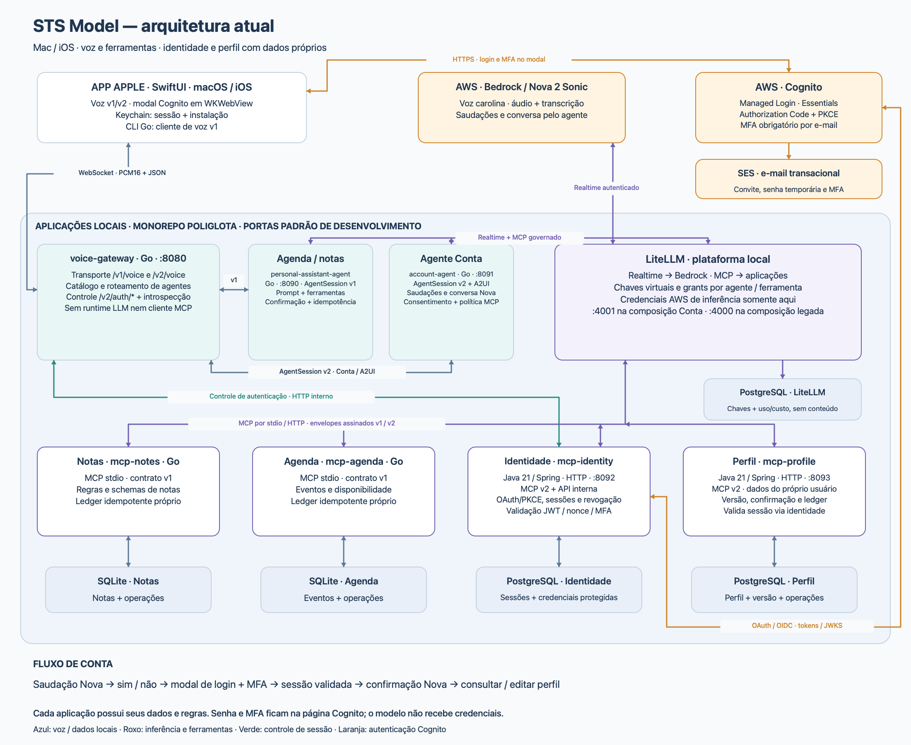

# Arquitetura



O diagrama representa o estado implementado. A fonte é
[`render_architecture.swift`](../scripts/render_architecture.swift); gere o PNG
com `make architecture-diagram` após alterar os fluxos.

```text
App Apple (macOS/iOS)                         AWS
  ├─ voz v1/v2 → voice-gateway                ├─ Bedrock / Nova 2 Sonic
  ├─ modal WKWebView ────────────────────────→├─ Cognito → SES (e-mail/MFA)
  └─ Keychain: instalação e refresh           └─ token endpoint / JWKS
                    │
voice-gateway (Go, :8080)
  ├─ /v1/voice → AgentSession v1 → personal-assistant-agent (:8090)
  ├─ /v2/voice → AgentSession v2 → account-agent (:8091)
  └─ /v2/auth/* e introspecção → API interna de mcp-identity (:8092)

Agentes → LiteLLM (chaves e grants separados por agente/ferramenta)
  ├─ Realtime → Bedrock / Nova 2 Sonic
  ├─ PostgreSQL próprio → chaves e uso/custo, sem conteúdo da conversa
  ├─ MCP stdio / envelope v1
  │    ├─ mcp-notes  → SQLite de notas + ledger
  │    └─ mcp-agenda → SQLite de agenda + ledger
  └─ MCP HTTP / envelope v2
       ├─ mcp-identity (:8092) → PostgreSQL de identidade
       │    └─ adaptador Cognito: OAuth/PKCE, JWT, nonce, MFA e revogação
       └─ mcp-profile (:8093) → PostgreSQL de perfil + versão/ledger
            └─ valida sessão pela API interna de mcp-identity
```

## Responsabilidades

- App Apple: captura/reprodução, agentes, A2UI restrita, modal de login com
  WebView temporária e Keychain. Senha/MFA são preenchidos na página Cognito;
  não há bridge JavaScript ou envio desses campos ao modelo. O CLI Go é cliente
  do protocolo de voz v1.
- Voice gateway: WebSocket público, autenticação local, catálogo de agentes,
  limites, heartbeat e tradução Voice/AgentSession. O canal de controle valida
  sessões na identidade; não executa o runtime de conversa nem chama ferramentas MCP.
- Personal assistant agent: conversa de Agenda/notas, prompt, histórico limitado,
  ferramentas, autorização, confirmação e idempotência.
- Account agent: conversa Conta, apresentação e confirmação pela Nova Sonic,
  consentimento de login, UI A2UI e políticas para identidade/perfil.
- Identidade: transações OAuth/PKCE, integração Cognito, credenciais opacas,
  vínculo ao dispositivo, renovação/revogação e persistência própria.
- Perfil: dados básicos do próprio usuário, controle de versão e ledger;
  valida a sessão por API de identidade antes de acessar seus próprios dados.
- Notes/Agenda: contratos, regras e SQLite/ledger exclusivos de cada aplicação.
- LiteLLM: inferência Bedrock, credenciais AWS de inferência, chaves virtuais,
  grants MCP, guardrails e uso/custo sem conteúdo. O agente não possui SigV4 ou
  fallback direto para Bedrock. O controle OAuth usa diretamente a identidade.

Domínios são capacidades de negócio. Go, Java/Spring, SQLite e PostgreSQL são
escolhas técnicas; os bancos de identidade, perfil e plataforma são separados.
As bibliotecas `packages/go/realtime`, `actionruntime`, `agentwire`, `voicewire`
e `mcpwire` não possuem regras ou dados de negócio de outras aplicações.

## Fluxo Conta

1. Sem sessão, o agente pede à Nova Sonic que diga “Sou agente STS para logar
   sua conta, deseja continuar?”. A voz e a transcrição vêm do provedor.
2. A resposta afirmativa ou o botão de consentimento permitem criar a transação;
   uma negativa encerra a sessão. O modelo não antecipa a criação do login.
3. A A2UI validada abre “Entre com seus dados”. A conversa/microfone são
   interrompidos. Autenticar carrega Cognito na WebView do mesmo modal.
4. O callback passa pelo controle `/v2/auth/*`. Identidade valida transação,
   state, PKCE, nonce, tokens e configuração MFA; o app guarda o refresh no Keychain.
5. A nova sessão recebe identidade confirmada pelo gateway. Nova diz “Conta
   conectada com sucesso, agora você pode consultar e editar informações da sua conta”.
   Restaurar a sessão salva usa o mesmo caminho. Renovações técnicas não repetem a fala.
6. Consultas e alterações de perfil passam por MCP, contexto assinado e políticas.
   Alterações exigem confirmação e preservam versão/idempotência.

## Contratos, operação e limites

- Voice v1 e AgentSession v1 preservam Agenda/notas; Conta acrescenta Voice v2,
  AgentSession v2, A2UI e envelope MCP v2 nos contratos dos respectivos provedores.
- Entrada de voz: PCM16 LE mono 16 kHz. Saída: PCM16 mono 24 kHz.
- Agentes escutam em loopback. Fora de loopback, o app exige HTTPS/WSS.
- A composição Conta expõe LiteLLM em `4001`; a legada usa `4000`. São
  composições de desenvolvimento, com credenciais e bancos próprios.
- O fake é explícito e não comprova ASR, login Cognito ou MFA. O envio SES de
  desenvolvimento respeita o sandbox e os destinatários verificados.
- Mutações de resultado desconhecido não são repetidas automaticamente.
- Diagramas, exemplos e políticas versionados não contêm identificadores reais
  da conta AWS ou credenciais. O ambiente efetivo fica nos arquivos locais ignorados.

Consulte o [guia Conta](domains/account-development.md),
o [guia AWS](domains/account-aws-setup.md) e o
[runbook Nova/LiteLLM](nova-litellm-runbook.md).
