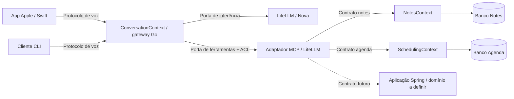

# Análise de domínios — STS Model

Data: 2026-09-27. Registro histórico da análise antes da migração.
As evidências abaixo referem-se ao commit `fc373898`; os caminhos atuais e
a execução estão no [registro de implementação](migration-review.md).
Método: seis fases de `harness/skills/domain-analysis/SKILL.md` (Tech Leads
Club). Escopo: código versionado Go/Swift, contratos, testes, build e deploy.

## Resultado

Há três capacidades de negócio observáveis: conduzir conversas por voz,
manter notas e gerenciar uma agenda. A conversação contém a governança de
execução de ações como módulo coeso. Não há evidência suficiente para separar
essa governança em outra aplicação ou bounded context agora.

O repositório já tem vários executáveis, não um único processo: gateway,
MCP Notes, MCP Agenda, cliente CLI e app Apple. LiteLLM é uma dependência de
plataforma. O alvo é um monorepo de aplicações autônomas, cada uma organizada
por módulos de negócio; o gateway será um monólito modular. Uma futura app
Spring pode seguir o mesmo modelo sem pertencer ao processo Go.

Core/supporting são hipóteses baseadas no produto atual de assistência por
voz. Se Agenda virar o produto principal, sua classificação deverá mudar.

## Inventário e linguagem

| Contexto proposto | Conceitos e casos de uso observados | Evidência atual | Dados sob responsabilidade |
| --- | --- | --- | --- |
| Conversação | sessão, turno, interrupção, transcrição, retomada | `internal/session/session.go`, `internal/gateway/voice.go`, `internal/gateway/nova.go` | Estado efêmero de sessão/turnos; sem armazenamento de conteúdo |
| Conversação / execução de ações | ferramenta permitida, operação pendente, confirmação posterior, resultado desconhecido | `internal/orchestrator/tools.go`: `Session`, `Plan`, `ObserveUser`, `Complete` | Estado efêmero da autorização e execução; ledger durável pertence ao app executor |
| Notas | nota identificada por ID, título, conteúdo, criação, busca e exclusão | `internal/storage/notes.go`: `Note`, `List`, `Mutate`; `internal/mcp/types.go`: `NotesTools` | `notes`, `operations`, migrações do banco de Notes |
| Agenda | evento agendado, intervalo, disponibilidade, conflito, cancelamento | `internal/storage/agenda.go`: `AgendaEvent`, `Slots`, `MutateAgenda` | `agenda_events`, ledger próprio e migrações de Agenda |
| Plataforma externa | modelo, chave virtual, uso/custo | `deploy/litellm/`, `internal/provider/nova/` | PostgreSQL de LiteLLM; credenciais AWS no LiteLLM |

“Evento” de `protocol.Event` é uma mensagem do protocolo de voz; `AgendaEvent`
é um compromisso. Não compartilhar uma entidade `Event`. “Sessão” em
`orchestrator.Session` é o estado de governança associado à conversa, enquanto
`session.Session` controla turnos/áudio. São modelos de módulos distintos
no mesmo contexto; devem ser traduzidos por APIs internas.

## Mapa de subdomínios e bounded contexts

### Conversação assistida — Core (hipótese)

Capacidade: levar uma solicitação falada a uma resposta e, quando permitido,
a uma ação verificável. Vocabulário: sessão, turno, interrupção, ferramenta,
confirmação, operação, resultado. Entidades/serviços: Session, Pending, Job,
Plan/Execute/Complete. Limite: interpreta a interação e autoriza ações; não
possui regras de disponibilidade ou persistência de notas.

Contexto sugerido: ConversationContext. Módulos `conversation` e `actions`,
no mesmo deploy `voice-gateway`. App Apple e CLI são consumidores do protocolo
desse contexto, não novos domínios só por serem clientes diferentes.
Integração: publica voz em `/v1/voice`; consome contratos de Notes/Agenda por
adaptadores MCP e inferência pelo adaptador Realtime/LiteLLM. A tradução de
nomes, schemas e resultados é uma camada anticorrupção. Notas/Agenda são
upstream de suas capacidades; conversação é downstream. Não existe relação
direta necessária entre Notes e Agenda.

### Notas — Generic

Capacidade: registrar, buscar e remover informações textuais. Vocabulário:
nota, título, conteúdo, busca, exclusão. Entidade Note; casos de uso List e
Mutate. Limites atuais: título até 256 bytes e conteúdo até 8192 bytes na
validação Go; JSON Schema também impõe limites de caracteres, uma diferença
que deve ser coberta na migração poliglota. Confirmação da exclusão é validada
no adaptador MCP; criação/remoção e replay são atômicos no armazenamento.

Contexto sugerido: NotesContext, aplicação `mcp-notes`. Publica `notes.*`;
não consome Agenda ou Conversação para executar regras. Recebe contexto
confiável do host via adaptador; é dono do banco e da transação. Classificado
como genérico porque CRUD/busca de notas não mostram diferenciação atual.

### Agenda — Supporting (hipótese)

Capacidade: consultar horários/eventos, criar e cancelar agendamentos sem
conflitos. Vocabulário: intervalo, disponibilidade, duração, evento ativo,
evento cancelado. Regras atuais: America/Sao_Paulo, dias úteis 09–18h,
intervalos com instantes absolutos, consultas até 31 dias, slots de 15–240
minutos em múltiplos de 15. Cancelamento exige confirmação; criação e ledger
ocorrem na mesma transação. São regras próprias da agenda fictícia da POC.

Contexto sugerido: SchedulingContext, aplicação `mcp-agenda`. Publica
`agenda.*`, resultados e erros de negócio; não consome Notes. UTC é a base de
persistência, `start_local/end_local` são projeções calculadas pela aplicação.
O cliente pode ajudar a interpretar a fala, mas não deve decidir conflitos.

### Capacidades genéricas de plataforma

Inferência, transporte MCP/WS, autenticação técnica, telemetria e configuração
não justificam novos bounded contexts de negócio locais. São adaptadores ou
serviços externos. Uso/custo permanece no LiteLLM; não criar um domínio local
de billing apenas por existir PostgreSQL. Compartilhar código técnico somente
se ele não importar modelos ou políticas específicas de Notes/Agenda.

## Coesão

Estimativas de revisão estática, não métricas automatizadas. A skill apresenta
uma divisão por 10 e faixas 0–10; aqui usamos a soma bruta em 0–10. L = linguagem
(0–3), U = uso conjunto (0–3), D = relações de dados (0–2), M = mudança (0–2).
Não foi feita análise histórica de coalteração; M é desconhecido e o total é
um intervalo. Coesão baixa entre contextos independentes é esperada.

| Grupo interno | L | U | D | M | Total | Fundamentação |
| --- | --- | --- | --- | --- | --- | --- |
| Conversação | 3 | 3 | 2 | ? | 8–10 | Turnos, sessão e ações colaboram no mesmo ciclo |
| Notas | 3 | 3 | 2 | ? | 8–10 | Operações sobre a mesma entidade e ledger |
| Agenda | 3 | 3 | 2 | ? | 8–10 | Intervalos, conflitos e eventos compartilham invariantes |
| Pacote `storage` atual | 1 | 1 | 0 | ? | 2–4 | Notes e Agenda não têm relação de negócio entre seus dados |

| Contextos | L/U/D/M | Coesão | Acoplamento observado | Recomendação |
| --- | --- | --- | --- | --- |
| Notes ↔ Agenda | 0/0/0/? | 0–2 | Agenda embute Store e inicializa schema de Notes | Donos de persistência separados |
| Conversação ↔ Agenda | 1/2/0/? | 3–5 | Nomes, frases e validação de datas no host | Contrato + perfil de integração confiável |
| Conversação ↔ Notes | 1/2/0/? | 3–5 | Políticas e frases por nome no host | Mesmo mecanismo de perfis |

## Problemas priorizados

1. **Alta — persistência de Agenda depende de Notes.**
   `internal/storage/agenda.go`: `type Agenda struct{ *Store }`, `OpenAgenda`
   chama `Open` de Notes e cria inclusive `notes`. Os entrypoints usam caminhos
   diferentes por padrão, portanto isso não prova que compartilhem o mesmo
   arquivo em runtime; o acoplamento é de implementação/schema. Separar
   repositories e migrações preservando o ledger transacional de cada app.
2. **Alta — transporte MCP conhece aplicações.**
   `internal/mcp/server.go` contém `Serve` específico de Notes e `ServeTools`
   genérico; `types.go` contém `NotesTools`; `agenda.go` contém schema e handler
   de Agenda; `router.go` usa ambos nos placeholders e `validateBuiltInPolicy`.
   Extrair adaptadores e catálogos para os donos; transporte fica neutro.
3. **Alta — extensibilidade depende de editar regras do host.**
   `internal/orchestrator/tools.go` ramifica por `notes.*`/`agenda.*`, possui
   frases e `explicitAgendaIntent`; `agenda_format.go` trata datas de Agenda.
   Introduzir perfis confiáveis de integração com nomes/políticas/frases e
   mover validação de negócio para servidores. Preservar confirmação posterior
   e comportamento de retry. Annotations remotas não podem conceder permissão.
4. **Média — deploy acoplado à imagem LiteLLM.**
   `deploy/litellm/Dockerfile` compila e embute ambos os binários Go.
   `scripts/dev.py` mapeia aliases memo/local e assume dois tipos de app.
   Parametrizar catálogo de apps; separar empacotamento quando houver transporte
   remoto validado. Manter stdio como transição explícita.
5. **Média — módulo Go na raiz representa todas as apps.**
   `go.mod`, `cmd/`, `internal/` permitem dependências indevidas entre apps.
   Após separar responsabilidades, mover para módulos por aplicação; o build
   da raiz será um agregador, não um runtime universal.
6. **Média — documentação diverge da política efetiva.**
   `docs/mcp-integration.md` diz que criações exigem intenção explícita; `Plan`
   dispensa a verificação de frase para `notes.create`/`agenda.create_event`.
   Caracterizar e documentar a semântica existente antes de generalizar políticas,
   sem mudar comportamento incidentalmente na refatoração.

## Context map alvo

MCP e LiteLLM são interfaces/plataforma, não domínios. Os servidores publicam
uma linguagem de integração explícita (schemas, resultados, erros e contexto
assinado). O futuro MCP Spring é possibilidade arquitetural, não domínio
identificado no código. Dentro de cada monólito, módulos usam APIs internas;
entre apps, contratos de processo/rede. Não há necessidade atual de event bus.
